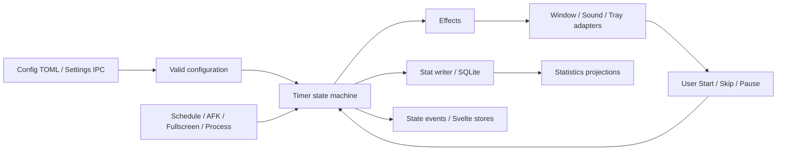

# Eyezen 全维度系统审计报告

- 审计日期：2026-07-15
- 审计对象：`main` 分支，HEAD `6768902`
- 产品版本：v0.7.1
- 任务目录：`.trellis/tasks/07-15-system-audit`
- 结论性质：当前仓库内部健康基线，不等同于生产可用性、医疗有效性或三平台发布验收

## 1. 执行摘要

**总分：60/100，证据置信度 B。**

仓库已经具备较扎实的工程底座：本地聚合 CI 全绿、Rust 267 项测试通过、前端覆盖率超过既定门槛；17 个 Tauri Commands 与 17 个自动生成 permission 一一对应，默认 capability 为空，事件监听使用白名单，SQLite 迁移、三平台 CI、default/no-default feature 路径和依赖治理均有自动化痕迹。近期提交也体现了主动 hardening、拆分和减法意愿。

但当前绿色检查没有覆盖六条承重负路径：合法配置组合可使 timer task panic；提醒超时合同与规范相反并污染 Taken 统计；设置并发保存可丢更新；统计 writer 在队列满时可能无法关闭；导出先删旧备份再写新文件；提醒窗口完全创建失败时状态机仍继续推进。它们都位于“配置 → 计时 → 提醒 → 用户动作 → 统计”的主路径上，因此没有 P0，不代表可以直接判定发布就绪。

当前最重要的治理判断是：

> 不继续增加兜底分支，而是把完整配置、提醒呈现结果、配置写入版本和统计写入语义提升为边界合同；内部只接收已经成立的不变量。

### 1.1 严重度概览

| 严重度 |  数量 | 结论                                                          |
| ------ | ----: | ------------------------------------------------------------- |
| P0     |     0 | 未发现已证实的数据毁损、安全失陷或默认路径完全不可用          |
| P1     |     6 | 均有直接源码证据、触发条件、根因链和最小修复切片              |
| P2     | 13 组 | 统计口径、可访问性、平台探测、Module Locality、文档与发布门禁 |
| P3     |  5 组 | 低 Surface 体验深化与排熵自动化                               |

### 1.2 立即决策

1. 先修 P1-01 至 P1-06，再讨论功能扩张。
2. `Alerting` 超时应恢复为“自动消失并记 Skipped”；若产品确实要自动开始休息，必须先形成新的可追溯理由和用户可见合同。
3. 不新增“兼容旧配置”的双读逻辑；开发期直接让所有配置入口通过同一个 `ValidConfig` 边界。
4. 统计导出在没有跨平台原子替换能力前，宁可拒绝覆盖已有文件，也不能先删除旧备份。
5. 发布评分与内部健康评分分开；三平台实机、辅助技术、资源和签名未验收，不得由 CI 绿色外推。

## 2. 方法、证据与边界

### 2.1 证据分层

| 标签     | 含义                                         | 本报告用法                                                               |
| -------- | -------------------------------------------- | ------------------------------------------------------------------------ |
| 外部事实 | 官方机构、标准、平台文档或原始研究           | 由 [research/user-pain-points.md](research/user-pain-points.md) 统一拥有 |
| 仓库事实 | 当前源码、测试、配置、Git 历史或实际命令输出 | 给出路径、符号或行号                                                     |
| 推断     | 由事实推导出的产品或架构判断                 | 明确写出根因链与验证方式                                                 |
| 未知     | 当前仓库和本机环境不能回答                   | 单列，不以解释性文字填空                                                 |

本报告沿用两套审计语言：

- Keel：架构是“被持续执行的约束 × 可追溯的理由链”，检查 Spine、Surface、Truth、Ownership、Negative path、Time、Guards、Budget。
- codebase-design：使用 Module、Interface、Implementation、Seam、Adapter、Depth、Leverage、Locality；Interface 同时是测试面。

### 2.2 实际运行的检查

| 检查                                                    | 结果           | 证据边界                                                                                                                               |
| ------------------------------------------------------- | -------------- | -------------------------------------------------------------------------------------------------------------------------------------- |
| `npm run ci`                                            | 通过，265.6 秒 | 8 步：version sync、Rust fmt、clippy、267 tests、Svelte check、Vitest coverage、Prettier、frontend build；定义见 `scripts/ci.mjs:3-23` |
| 前端 coverage                                           | 通过           | lines/statements 94.03%，functions 91.72%，branches 92.34%；来源 `coverage/coverage-summary.json`                                      |
| `cargo deny --manifest-path src-tauri/Cargo.toml check` | exit 0         | advisories/bans/licenses/sources 均 ok；有 stale license allow、重复依赖和 yanked `spin 0.9.8` 警告                                    |
| `git diff --check -- . ':(exclude).codex/config.toml'`  | 通过           | 明确排除用户已有配置改动                                                                                                               |
| bindings/permissions tracked diff                       | 无             | CI 后 `src/lib/bindings`、`src-tauri/permissions` 无 tracked diff                                                                      |

未运行或未验收：

- Tauri GUI、安装包、系统自启动、系统通知和长期后台运行；
- Windows/macOS/Linux 三平台真机；
- Narrator、VoiceOver、Linux 辅助技术，高对比度、200% 缩放；
- CPU、内存、启动时间、窗口出现延迟、休眠/唤醒基线；
- macOS 签名/公证、Windows 签名、Linux 包分发；
- 当前提交的本地 Rust coverage 数字；仓库 CI 有 coverage job，但本次只静态核对其定义。

### 2.3 工作树边界

`.codex/config.toml` 是任务开始前的用户改动。本任务未编辑该文件、未将其内容作为审计证据，并在 diff 检查与后续提交中排除；续做质量检查仅查看其差异以确认归属。除 Trellis 审计任务目录外，没有修改产品代码、依赖、数据库、capability 或发布配置。

## 3. 九维评分

| 维度                  |   得分 |    权重 | 判断                                                                                  |
| --------------------- | -----: | ------: | ------------------------------------------------------------------------------------- |
| 需求证据与产品范围    |      7 |      10 | 一手研究和非目标清晰；缺真实目标用户、留存和提醒偏好证据                              |
| UI/UX 与可访问性      |      6 |      12 | 主路径完整且低打扰方向正确；低对比度、动效、焦点和错误静默未闭合                      |
| 架构约束与理由链      |      8 |      15 | 状态机、分层和规范可定位；核心合同已有代码/规范漂移，负路径收据不足                   |
| Module 深度与代码质量 |      9 |      15 | 纯状态机和平台 seam 有 Depth；Timer Locality、EffectSink、TrayPort 和大文件仍偏浅     |
| 正确性与测试          |      8 |      13 | 自动化数量和覆盖率强；合法组合、乱序、队列满、导出失败等关键测试缺失                  |
| 安全、隐私与平台边界  |      8 |      10 | capability/CSP/permission 收敛良好；数据删除、数据流披露和 degraded capability 未闭合 |
| 性能、资源与可靠性    |      3 |       8 | 后台热路径无基线，每秒平台 IO 候选明显，README 资源声明未验证                         |
| 文档、验收与发布工程  |      5 |       8 | workflow 较完整；CI 步数、分支、cargo-deny、截图、版本文案和 tag gate 漂移            |
| 可维护性与排熵能力    |      6 |       9 | 近期有 hardening 和守卫；没有统一历史快照，重复事实与大 Module 仍在增长               |
| **合计**              | **60** | **100** | **实现与自动化可核验，但缺实机、趋势和承重负路径闭环：B**                             |

评分不把同一问题重复扣分。例如配置非法状态主要扣在架构，而其测试缺口不再按完整影响重复扣一次。

## 4. 仓库与承重主路径

### 4.1 仓库地图

| 区域            | 入口/所有者                                                 | 作用                                                 |
| --------------- | ----------------------------------------------------------- | ---------------------------------------------------- |
| Rust/Tauri 装配 | `src-tauri/src/lib.rs`、`services/mod.rs::AppServices`      | 创建 9 个运行时 Service，定义生命周期和 Command 注册 |
| 计时核心        | `services/timer/{state,machine,service,effect*}.rs`         | 5 个状态、用户事件、时间转换和 8 类 Effect           |
| 配置            | `models/config.rs`、`services/config.rs`、`commands/mod.rs` | TOML schema、加载/原子保存、IPC 边界校验             |
| 统计            | `services/stat/`、`models/statistics.rs`                    | SQLite migration、writer、查询、指数和导出           |
| 平台能力        | `platform/{windows,macos,linux}.rs`、`services/detector.rs` | idle/fullscreen/foreground process Adapter           |
| 窗口与托盘      | `services/window.rs`、`services/tray.rs`                    | 多屏提示窗口、托盘面板、菜单和导航                   |
| 前端入口        | `src/entries/`、`src/pages/{main,tray,tip,tip-minimal}/`    | 四个 WebView Surface                                 |
| 前端跨界        | `src/lib/{commands,events,stores}/`                         | IPC timeout、事件订阅、Config/Timer/Cycle stores     |
| 权限            | `src-tauri/capabilities/`、`src-tauri/permissions/`         | window capability、Command permission、事件白名单    |
| 构建发布        | `package.json`、`scripts/ci.mjs`、`.github/workflows/`      | 本地 CI、三平台 CI、coverage、cargo-deny、release    |
| 文档规范        | `README.md`、`docs/`、`.trellis/spec/`                      | 产品声明、开发/发布流程、跨层合同                    |

持久化为本地 `config.toml` 与 SQLite `data.db`；schema 演进由 `services/stat/migration.rs` 拥有，导出通过 SQLite `VACUUM INTO`。

### 4.2 承重路径

当前 P1 全部落在这条路径上：A→B 的合法性、C 的超时语义、E→F 的呈现收据、G 的并发配置、H 的关闭/导出。

### 4.3 公共 Surface 快照

| Surface            | 当前数 | 说明                                                      |
| ------------------ | -----: | --------------------------------------------------------- |
| Tauri Commands     |     17 | 与 17 个自动生成 permission 一一对应                      |
| 跨窗 Events        |      5 | capability 中显式白名单                                   |
| Config 字段        |     23 | Timer/Pomodoro/Behavior/Display/Schedule/Hotkeys          |
| `AppServices` 字段 |      9 | config/timer/detector/window/sound/stat/tray/i18n/hotkeys |
| Timer states       |      5 | Working/PreAlert/Alerting/Resting/Paused                  |
| Timer Effects      |      8 | 显示、声音、托盘、统计、状态等                            |
| 生成文件           |     46 | 29 个 bindings + 17 个 permissions；当前无手改 diff       |

Surface 数量是当前基线，不代表越少越好；后续关注每次功能交付净增长和退休量。

## 5. 需求、痛点与产品边界

详细一手来源及证据限制见 [research/user-pain-points.md](research/user-pain-points.md)。公开研究不能替代 Eyezen 真实用户研究。

| 痛点                                         | 证据支持                                    | 当前能力                              | 主要差距                                                        |
| -------------------------------------------- | ------------------------------------------- | ------------------------------------- | --------------------------------------------------------------- |
| 数字视觉疲劳存在，但 20-20-20 精确疗效不确定 | AOA/NIOSH 建议 + 原始小样本研究的限制       | 可配置 20-20-20/Pomodoro              | “protects your eyes”、Eye-Care Index 容易越过行为指标边界       |
| 中断会产生压力和恢复成本                     | 原始 HCI 中断研究、Apple/Microsoft 通知指导 | 预提醒、全屏/AFK/白名单/schedule 抑制 | 超时自动休息、抢焦点、缺静默时段和失败解释                      |
| 眼部远眺不等于身体活动                       | WHO/NIOSH/OSHA                              | 20 秒与 Pomodoro 均支持               | 文案和统计需明确“计时器休息”，不能推断活动完成                  |
| 可恢复节律优于 streak 惩罚                   | 习惯形成原始研究                            | rhythm/streak、7/30 日趋势            | 最长连续工作与 streak 公式存在误导，休息日语义不稳定            |
| 本地优先仍需透明与删除                       | W3C/NIST 隐私原则                           | 本地 TOML/SQLite、导出                | 无完整数据清单、保留说明和清空统计操作                          |
| 提醒器本身必须可访问                         | WCAG 2.2、平台官方指南                      | 基础按钮/文本/主题                    | reduce motion、对比度、键盘 tooltip、屏幕阅读器和多屏焦点未闭合 |

### 5.1 应保持的产品定义

Eyezen 的核心工作是：在不破坏关键工作、不扩大隐私采集、不制造健康焦虑的前提下，帮助桌面工作者形成可持续、可解释、可自主调整的屏幕休息节律。

### 5.2 明确非目标

- 不做医疗诊断、疗效承诺、风险百分比或“AI 预测眼疲劳”。
- 不采集摄像头、窗口标题、完整应用时间线、键鼠历史。
- 不扩张为姿势、睡眠、心理健康、运动综合评分平台。
- 不引入云账户、排行榜和社交 streak。
- 不为三个平台复制三套计时业务流；差异停留在 Platform Adapter。

## 6. UI/UX 任务流审计

| 任务流       | 当前证据                              | 问题                                                   | 验收                                                     |
| ------------ | ------------------------------------- | ------------------------------------------------------ | -------------------------------------------------------- |
| 首次启动     | main/tray/config 默认值完整           | 没有真实 onboarding 与权限拒绝实测                     | 新用户 60 秒内理解运行位置、暂停、退出和本地数据         |
| 日常等待     | tray 状态、预提醒、skip flags         | 每秒探测全部平台条件；为什么未提醒不透明               | tray 可解释当前/最近抑制原因，不保存应用历史             |
| 正式提醒     | 多屏窗口、开始/跳过、超时             | 主窗口默认 focused；窗口全失败不影响状态；超时自动休息 | 不抢输入；只有一个可访问主 Surface；无可见窗口不计 Taken |
| 暂停/恢复    | 状态机保存 `paused_from` 与 remaining | 基础合同和测试较好                                     | Working/PreAlert/Alerting/Resting 均按剩余时间恢复       |
| 设置即时保存 | section 级 IPC 更新                   | 同 section 并发覆盖；失败多为 console-only             | 乱序完成不丢字段，错误在控件附近可见，可明确重试         |
| schedule     | enabled + active_days                 | disabled 时统计仍可能按 active_days 标休息日           | disabled 表示不解释工作日，UI/统计共享同一规则           |
| 统计         | trends、cycle outcomes、ECI/rhythm    | 双写、错误静默、历史最佳窗口仅 45 天、健康化命名       | 数据来源唯一、错误/空态可见、公式和范围可解释            |
| 导出         | Save dialog + VACUUM INTO             | 覆盖目标先删除旧文件                                   | 任一失败保持旧文件逐字节不变                             |
| 后台/退出    | Service shutdown、有外层 timeout      | stat queue 满时内部 await 可挂                         | 填满队列后仍可在明确期限内排空并退出                     |

### 6.1 可访问性高风险候选

- `TipMinimalApp.svelte:42-55` 有无限 breathing 动画，无 `prefers-reduced-motion`。
- Tray 也存在无限动画和大量硬编码颜色，偏离 CSS 变量单一事实源。
- Resting 截图中的说明/Skip、Settings 辅助文字为低对比度高风险；需以最终背景计算，不把静态观感冒充 WCAG 测量。
- `EciDisplay.svelte` tooltip 锚点是不可聚焦 `span`。
- `ActivityRibbon.svelte:64` 的 marker 位于 `role="presentation"` 容器，无可访问列表/表格投影。
- Suppressed 展开按钮的可访问名称只有 `+`/`-`。
- `TrendChart.svelte:130` 初始化失败只写 console；`cycle-outcomes.svelte.ts:38` 捕获后 resolve，页面未渲染 store error。
- `MainApp.svelte:26` 和 `HotkeySection.svelte:101` 有空 catch，外部解绑失败无上下文。

建议把可访问性作为现有提醒 Interface 的实现约束，不建立平行“无障碍模式”。

## 7. Keel 架构诊断矩阵

| Slot          | 当前答案                                                               | 发现                                                                                            |
| ------------- | ---------------------------------------------------------------------- | ----------------------------------------------------------------------------------------------- |
| Spine         | 配置→Timer→Effect→窗口/用户→统计→投影                                  | 主路径可定位，但 Effect 路由和 skip 决策泄漏到 `ServiceContext`                                 |
| Surface       | 17 Commands、5 Events、23 config 字段、schema、跨 Module traits        | permission 收敛；config section replace、EffectSink 9 方法和 TrayPort 8 方法的事实合同偏大      |
| Truth         | Config model、Timer machine、SQLite schema、生成 bindings 分别有 owner | `state_snapshot`/`state_payload`、两张统计表、CI 步骤/文档存在重复真相                          |
| Ownership     | `AppServices` 与三层 spec 基本明确                                     | timer loop、抑制策略、Effect 执行由 context/timer 分担；超时提交改代码和测试未改规范            |
| Negative path | IPC timeout、AppError、配置原子写、migration failure 有处理            | 合法组合 panic、窗口失败无收据、store 错误静默、导出先删、Shutdown sentinel 丢失                |
| Time          | Timer/Paused/migration 有时间轴测试                                    | 配置响应乱序、queue full shutdown、休眠/唤醒、DST/跨午夜和事件重放未闭合                        |
| Guards        | CI、coverage、cargo-deny、permission generation、version sync          | 本地 `npm run ci` 不含 cargo-deny/Rust coverage；release tag job不复跑完整 gate；文档守卫会漂移 |
| Budget        | 近期多轮 hardening，有生成物和 public Surface 基线                     | 没有连续快照；大 Module、stale allow、版本文案和无效 Effect 尚未形成退休批次                    |

结论：架构并非缺少分层图，而是部分关键约束只存在于文档或测试中的一侧。理由链一旦与实现分叉，约束乘积归零。

## 8. Module、Interface、Seam 与 Adapter

| Module           | Interface / Seam                        | 依赖分类与 Adapter                         | Depth / Locality 判断                                                                                    |
| ---------------- | --------------------------------------- | ------------------------------------------ | -------------------------------------------------------------------------------------------------------- |
| Timer            | Commands、state events、5 状态/8 Effect | 核心为 in-process；窗口/声音/统计经 Effect | 纯转换有 Depth；tick、skip、Effect orchestration 泄漏到 context，Locality 中等偏低                       |
| Config           | get/update section、watch、TOML         | filesystem 为 local-substitutable          | 原子保存有 Depth；完整配置不变量未隐藏，调用者必须理解跨 section 关系                                    |
| Stat             | enqueue/query/export/shutdown           | SQLite 为 local-substitutable              | migration/query 有 Depth；双表双写、shutdown sentinel 和覆盖导出泄漏负路径                               |
| Platform         | `PlatformApi` seam                      | Windows/macOS/Linux 三个真实 Adapter       | seam 成立且 Leverage 高；bool capability 无法表达 degraded                                               |
| Effect execution | `EffectSink` 9 方法                     | ServiceContext + RecordingSink             | 测试 seam 真实，但 Interface 几乎逐项复制 Effect，Depth 低；`Option<&dyn EffectSink>` 允许生产不变量缺失 |
| Tray             | `TrayPort` 8 个低层窗口/菜单操作        | Tauri runtime + FakeTrayPort               | seam 真实；调用者仍编排 emit/unminimize/show/focus，Interface 偏浅                                       |
| Frontend Config  | section components → commands/store     | Tauri IPC + Vitest mocks                   | 控件简单；保存顺序、错误和并发知识散落到每个 section，Locality 低                                        |

### 8.1 删除测试

- 删除 Timer machine：状态、时间和 Effect 复杂度会扩散到多个调用者，Module 有真实 Depth，应保留并继续深化。
- 删除 `PlatformApi`：三平台条件编译与探测会扩散，seam 有真实价值。
- 删除 `EffectSink`：Effect 分派仍存在，但 9 个镜像方法的 Interface 复杂度会消失；应改为一个完整执行操作或由 Timer-owned executor 深藏，而不是再叠一层 trait。
- 删除 `TrayPort`：Tauri 调用会扩散，seam 应保留；但 Interface 应提升为“显示主窗口”“显示托盘面板”等完整操作，旧的低层编排和对应实现细节测试随替换删除。

### 8.2 大文件与停止信号

| 文件                  | 总行 | 生产实现约数 | 两个可命名责任                                                 |
| --------------------- | ---: | -----------: | -------------------------------------------------------------- |
| `services/tray.rs`    | 1475 |          858 | tray domain orchestration；Tauri runtime Adapter/geometry      |
| `timer/machine.rs`    |  995 |          276 | 纯转换/effect derivation；大量行为测试                         |
| `services/hotkeys.rs` |  939 |          609 | binding reconciliation；Tauri plugin Adapter/status projection |
| `services/window.rs`  |  692 |          334 | monitor layout/spec；Tauri window lifecycle                    |
| `services/context.rs` |  625 |          448 | application assembly/watch；timer tick/effect routing          |
| `services/config.rs`  |  512 |          241 | Config persistence；watch/snapshot tests                       |

`HotkeyInner::apply_config` 约 85 行，超过项目 80 行停止信号。拆分只应沿“计算 reconciliation plan”和“执行/回滚外部注册”两个责任，不按行数机械切函数。

## 9. P1 发现登记

### P1-01 合法配置组合可终止 timer task

- **事实证据**：`commands/mod.rs:119-157` 只以 `TimerConfig.work_minutes` 校验 pre-alert；`commands/mod.rs:197+` 独立校验 `PomodoroConfig`。UI 允许 `focus_minutes=1` 与 `pre_alert_seconds=60`（`TimerSection.svelte:91-132`）。Pomodoro work duration 取 focus，`timer/state.rs:262-267` 对 `work_duration - pre_alert_duration` 使用 `expect`。磁盘加载 `services/config.rs:119` 只做 TOML 解析。
- **触发条件**：mode=pomodoro、focus=1 分钟、pre-alert=60 秒；各 section 单独合法，组合不合法。
- **影响**：核心 timer task panic，提醒停止；磁盘手改配置可在启动路径触发。
- **根因链**：外部 Config 被拆段校验 → 内部仍接受可表达的非法组合 → `expect` 被错误地当作已证明不变量。
- **最小修复切片**：所有 IPC 更新和磁盘加载统一执行 `Config -> ValidConfig/TimerDurations`；内部 Timer 只接收派生后的正时长类型。删除为该非法状态服务的 `.max(1)`、`unwrap_or` 或延迟 `expect`，不增加兼容双读。
- **验收**：TOML load、update_timer、update_pomodoro、mode switch 四个入口对同一组合一致拒绝；边界值 property test；进入 Timer 的类型无法构造 `work <= pre_alert`。
- **Owner / 复查**：Config + Timer；修复合入时复查所有 Duration 派生点。
- **置信度**：高。

### P1-02 Alerting 超时合同漂移并污染 Taken 统计

- **事实证据**：规范 `ipc-and-state.md:399-402` 定义 `Alerting -> Working` 且计 skip；实现 `timer/machine.rs:68-70` 为 `Alerting -> Resting`，测试 `alerting_timeout_auto_rest`（约 522 行）固化该行为。之后 `Resting -> Working` 在 `machine.rs:258-259` 产生 `CycleOutcome::Taken`。提交 `c8812f4f` 修改实现和测试，未同步规范或记录产品理由。
- **触发条件**：提醒出现后用户不操作直至 timeout。
- **影响**：用户未接受休息也被自动进入 Resting，最终统计为 Taken；提醒控制权和数据可信度同时受损。
- **根因链**：行为变更没有 ADR/理由链 → 测试验证了新实现而非产品合同 → 统计只看后续状态转换。
- **最小修复切片**：恢复 `Alerting -> Working`，产生一次 Skipped cycle event，并同步测试；若未来选择自动休息，必须先更新 PRD/规范、UI 文案和 outcome 定义。
- **验收**：模拟 timeout 后 state=Working、outcome=Skipped、无 RestSession；显式 StartRest 才能进入 Resting/Taken。
- **Owner / 复查**：Product + Timer + Stat；发布前以行为测试阻断漂移。
- **置信度**：高。

### P1-03 设置快速修改会发生 lost update

- **事实证据**：`commands.ts:83-104` 以完整 section 替换；`TimerSection.svelte:22-34` 等组件每次从当前 `cfg` 快照构造请求，立即并发发送，没有 revision/pending 约束，失败多为 console-only。
- **触发条件**：同一 section 内连续修改两个字段，第二个请求在第一个响应前发出，响应顺序逆转。
- **影响**：后完成请求可把先完成字段写回旧值；UI 未明确告知，用户以为两项都已保存。
- **根因链**：replace-section Interface 没有并发合同 → 调用者各自编排读改写 → authoritative event 不能防止已发出的 stale request。
- **最小修复切片**：为 Config snapshot/update 增加单调 revision；后端拒绝 stale revision，Config store 成为每个 section 唯一保存 owner，控件不直接调用 Commands。冲突明确显示并重新加载，不静默重试覆盖。
- **验收**：用可控 Promise 逆序完成两个不同字段更新；最终持久化和 store 同时保留两项，stale request 得到可见错误。
- **Owner / 复查**：Frontend Config + backend Config；删除各 section 的重复 catch/直接 command 调用。
- **置信度**：高。

### P1-04 Stat writer 队列满时 shutdown 可能永久等待

- **事实证据**：`stat/mod.rs:373-381` 用 `try_send(Shutdown)` 后无论成功与否都 `handle.await`；发送失败时 `StatService` 仍持有 sender，writer 在排空后既收不到 sentinel，也看不到 channel closed。
- **触发条件**：shutdown 时 bounded channel 已满。
- **影响**：服务关闭挂起，依赖外层全局 timeout 强制结束；剩余写入和退出语义不确定。
- **根因链**：Shutdown 被建模为可能丢弃的普通消息 → sender 所有权未先关闭 → join 等待一个无法到达的终止条件。
- **最小修复切片**：shutdown 独占并 take sender，使用 `send(Shutdown).await` 等待队列腾位，再 drop sender 和 join；writer I/O 失败按现有错误链返回，不增加 silent fallback。
- **验收**：填满队列后调用 shutdown，writer 排空、收到 sentinel、在确定 timeout 内返回；重复 shutdown 有明确合同。
- **Owner / 复查**：Stat lifecycle；加入 queue-full 并发测试。
- **置信度**：高。

### P1-05 导出覆盖不是原子操作

- **事实证据**：`stat/mod.rs:230` 注释称 Atomically export；实现 `247-254` 先 `remove_file(target)` 再执行 `VACUUM INTO`。测试 `export_to_overwrites_existing_target_file` 固化覆盖能力，却没有“第二步失败后旧文件仍在”的测试。
- **触发条件**：目标已存在，删除成功后 VACUUM 因权限、空间、SQLite 或进程中断失败。
- **影响**：用户原备份被删除，新备份未生成。
- **根因链**：SQLite 要求 destination 不存在 → 调用者用删除满足前置条件 → 把两步操作误称原子。
- **最小修复切片**：立即把 Interface 收敛为“目标必须不存在”；若产品确认必须覆盖，再在同目录临时文件完成 VACUUM、校验和 fsync，并通过平台 Adapter 做最终原子替换。不得用“删旧后 rename”冒充原子。
- **验收**：向已有目标注入 VACUUM/替换失败，旧文件字节和 metadata 不变；成功产物可打开并核对行数。
- **Owner / 复查**：Stat export + Platform storage；先决定覆盖合同。
- **置信度**：高。

### P1-06 提醒可见性与统计成功未绑定

- **事实证据**：`window.rs:93-137` 在 monitor 枚举或所有窗口创建失败时只记录日志；`context.rs:190-198` 的 EffectSink 不返回呈现收据；状态机继续运行。主显示器 spec 在 `window.rs:129` 设 `focused=true`。当前超时语义还会进一步形成 Taken。
- **触发条件**：monitor API、WebView window creation 或多屏环境失败。
- **影响**：用户看不到提醒，系统仍可能认为已提醒/已休息；主屏窗口还可能抢走正在输入的焦点。
- **根因链**：ShowTipWindows 被建模为 fire-and-forget Effect → 状态机没有 `shown/failed` 输入 → 统计只能相信计划而非已呈现事实。
- **最小修复切片**：`show_tip_windows` 返回“至少一个窗口已显示”的 typed receipt；零窗口时触发专用 PresentationFailed 转换，回到 Working 并记录非 Taken 结果。默认窗口不抢焦点，只保留一个可交互/可宣告主 Surface。
- **验收**：0/N、部分 N、全部 N 窗口创建三组测试；0 窗口绝不 Taken，部分成功可操作且只宣告一次，键盘焦点保持在原应用。
- **Owner / 复查**：Window + Timer + Accessibility；三平台多屏实测。
- **置信度**：中高，焦点影响需实机确认。

## 10. P2/P3 汇总

| ID    | 级别 | 发现与证据                                                                                                | 最小方向                                                                     |
| ----- | ---- | --------------------------------------------------------------------------------------------------------- | ---------------------------------------------------------------------------- | --------------------------------------------------------------------------- | ------------------------------------------------------------ |
| P2-01 | P2   | `schedule.enabled=false` 时统计仍按 `active_days` 标周末休息日                                            | schedule owner 提供一个 `classify_local_date` 完整操作，UI/health 共用       |
| P2-02 | P2   | “最长连续工作”从当地午夜计算，把睡眠、关机和应用未运行时间纳入                                            | 只从可观测 activity segment 合并，跨缺口即断开                               |
| P2-03 | P2   | streak 初始门槛约为 `24h/work interval × 60%`，默认约 43 次/天；查询仅 45 天却标历史最佳                  | 改成明确窗口内的滚动一致性，名称包含窗口，不把 heuristic 当健康阈值          |
| P2-04 | P2   | 完成休息分别写 `activity_segments` 与 `rest_cycle_events`，无同一事务；趋势只读后者                       | 选择一个 cycle event 真相；activity projection 从其派生或同事务写入          |
| P2-05 | P2   | 非法 duration 静默变 0/`u32::MAX`，非法 reason 变 `None`                                                  | 在 SQLite row→domain 边界一次解析；损坏行显式错误，不在内部兜底              |
| P2-06 | P2   | 无“清空全部统计”完整操作及数据流披露                                                                      | 一个 Data Lifecycle Interface：位置、字段、导出、删除、重启验证              |
| P2-07 | P2   | ECI/“护眼指数”“需要关注”及 README `protects your eyes` 超出行为证据                                       | 改为“休息节律/执行情况”，公式透明，明确非诊断                                |
| P2-08 | P2   | Timer tick 每秒无条件解析全部 skip flags；macOS/X11/前台进程可能产生平台 IO                               | 仅在接近转换阈值时探测；同一 tick 缓存前台进程；建立 CPU/IO 基线             |
| P2-09 | P2   | Linux 以 `XDG_SESSION_TYPE=x11                                                                            |                                                                              | DISPLAY exists` 判 X11，Wayland+XWayland 会误判；macOS capability 固定 true | capability 改为 Supported/Unsupported/Degraded，探测失败可见 |
| P2-10 | P2   | cargo-deny 通过但存在 5 个未遇到 license allowance、重复依赖和 yanked `spin 0.9.8`                        | stale allow shrink-only；确认上游可升级路径和移除条件，不盲目 `cargo update` |
| P2-11 | P2   | CI/规范/文档漂移：8 步脚本、文档写 9 步；CI 只 main；spec 写 cargo audit；固定 Node/Rust 与 README 不一致 | 脚本为唯一事实源，文档引用或由检查生成；删除旧 dev/audit 叙述                |
| P2-12 | P2   | tag release 只做 version sync 后打包，未在 tag commit 复跑完整 CI/cargo-deny；签名/公证无证据             | release job 在 build 前依赖同 SHA 的完整 gate；签名状态作为产物元数据        |
| P2-13 | P2   | README About 截图仍为 v0.1.0/MIT，`tip_window.png` 命名与内容不符；i18n 残留 v0.6/v0.7 coming soon        | 截图/版本文案进入 release checklist，删除硬编码未来版本                      |
| P3-01 | P3   | `ResetWorkTimer` 生产实现仅日志，概念残留                                                                 | 在 Timer validity/transition 重构后删除 Effect、trait 方法和对应镜像测试     |
| P3-02 | P3   | `state_snapshot()` 与 `machine::state_payload()` 重复投影                                                 | 一个 owner，command 与 event 调用同一投影                                    |
| P3-03 | P3   | locale change 与 config-watch 有显式复制                                                                  | i18n Module 提供完整 apply-current-config 操作                               |
| P3-04 | P3   | 约 39 个 `.ok()/unwrap_or*/空 catch` 候选                                                                 | 按 boundary/internal/intentional 分类；不能把候选数量直接当缺陷              |
| P3-05 | P3   | Tray CSS 硬编码颜色与 tokens 双真相                                                                       | 迁回现有 CSS variables，不增加第二主题系统                                   |

## 11. 测试、验收与发布门禁

### 11.1 已有强项

- Rust 267 项测试与前端 coverage 门槛实际通过。
- CI 覆盖 Windows/macOS/Linux，Rust 有 no-default/default-feature 和 coverage 路径。
- migration 有正常、重复、partial/crash-like 测试。
- IPC timeout、permission generation、version sync、CSP 和事件白名单可定位。
- cargo-deny 两个 advisory ignore 均有理由和移除条件；本地检查 advisories/bans/licenses/sources 通过。

### 11.2 缺失的高价值测试

1. 完整 Config 的跨 section invariant，包括 TOML load。
2. Alerting timeout 的产品 outcome 合同。
3. Config update 响应逆序与 stale revision。
4. Stat queue-full shutdown。
5. export 已有目标 + 第二阶段失败保持旧文件。
6. window 0/partial/all success 与统计 receipt。
7. sleep/wake、wall-clock/DST、跨午夜和多屏热插拔。
8. store/ECharts failure 的用户可见错误和恢复。
9. reduce-motion、键盘、可访问名称、对比度自动检查。

### 11.3 独立发布门禁（不计入 60 分）

| 门禁                                | Windows            | macOS  | Linux              | 当前状态                 |
| ----------------------------------- | ------------------ | ------ | ------------------ | ------------------------ |
| 安装/升级/卸载/数据保留             | 未验收             | 未验收 | 未验收             | 阻塞发布结论             |
| 首次启动、tray、后台、退出          | 未验收             | 未验收 | 未验收             | 阻塞                     |
| fullscreen/AFK/process capability   | 未验收             | 未验收 | X11/Wayland 未验收 | 阻塞                     |
| 多屏、缩放、热插拔、焦点            | 未验收             | 未验收 | 未验收             | 阻塞                     |
| sleep/wake/DST/跨午夜               | 未验收             | 未验收 | 未验收             | 阻塞                     |
| Narrator/VoiceOver/AT、键盘、对比度 | 未验收             | 未验收 | 未验收             | 阻塞                     |
| CPU/RAM/启动/窗口延迟               | 无基线             | 无基线 | 无基线             | README 约 15 MB 不可采信 |
| 包签名/公证/校验和/回滚             | 未证实             | 未证实 | 未证实             | 阻塞                     |
| 数据导出/删除/隐私说明              | 导出有风险、无删除 | 同左   | 同左               | 阻塞                     |

## 12. 排熵基线

方向比绝对值重要。当前没有统一历史快照，因此以下只能作为 2026-07-15 基线，不声称上升或下降。

| Keel rot indicator        | 当前基线                                                                                                      | 可复现口径/判断                                                      |
| ------------------------- | ------------------------------------------------------------------------------------------------------------- | -------------------------------------------------------------------- |
| Suppression count         | Rust `allow` 33；前端 lint/type suppression 6（均在测试）；显式 skipped tests 0；cargo-deny advisory ignore 2 | `rg` 搜索属性、eslint/ts suppression、skip/ignore、deny exceptions   |
| Guard last-failed         | 未知                                                                                                          | CI 有运行记录，但仓库无统一“最后植入违规并失败”快照                  |
| Public surface growth     | 17 Commands、5 Events、23 config 字段                                                                         | 从 Command 注册、event 常量、Config schema 枚举；无历史同口径        |
| Concept count             | 9 AppServices、5 Timer states、8 Effects                                                                      | 从 `AppServices`、`TimerState`、`Effect` 枚举                        |
| Duplicate truth           | 至少 4 组已证实                                                                                               | state projection、统计双表、CI 步骤文档、版本/截图文案               |
| Ownership freshness       | 已出现漂移                                                                                                    | `c8812f4f` 改 timeout 实现/测试未改 spec；release/dev 文档落后       |
| Bypass frequency          | 未知                                                                                                          | 无一致的 direct-push/manual-release 历史计数，不用旧 devlog 代替趋势 |
| Sideways imports          | 当前未建立稳定计数                                                                                            | 三层规范声明方向，但缺连续 import-graph 快照                         |
| Hand-edited derived files | 46 个生成物；当前 tracked diff 0                                                                              | CI 后 bindings/permissions diff；后续只接受 generator 产生           |

### 12.1 第一批 subtraction batch

Owner：Config + Timer；完成期限建议为下一个 patch release 前。

1. 用 `ValidConfig/TimerDurations` 退休分散的跨字段假设和 duration fallback。
2. 统一 `state_snapshot/state_payload` owner。
3. 决定并统一 Alerting timeout 的代码、测试、规范与统计。
4. 在确认 `ResetWorkTimer` 没有生产语义后删除 Effect、EffectSink 方法和镜像测试。
5. 合入后重新记录 17/5/23、9/5/8、suppression 和 duplicate truth；连续三次上升才触发下一批减法，不新建治理平台。

## 13. 优化路线

### 13.1 立即止损（0–7 天）

| 顺序 | 切片                       | 收益                           | 风险/依赖                       | 验收/回滚                                      |
| ---: | -------------------------- | ------------------------------ | ------------------------------- | ---------------------------------------------- |
|    1 | P1-01 ValidConfig          | 防 timer panic，建立边界不变量 | 跨 Config/Timer；不保留旧双路径 | 四入口一致拒绝 + property test；可按单 PR 回滚 |
|    2 | P1-02 timeout 语义         | 恢复用户控制和统计可信度       | 需要产品确认默认选择            | 状态/outcome 行为测试；规范同 PR               |
|    3 | P1-04 stat shutdown        | 保证退出与写入排空             | 并发测试需可控 channel          | queue-full test                                |
|    4 | P1-05 安全导出             | 防旧备份丢失                   | 先收敛为 no-overwrite           | fault injection 保留旧 bytes                   |
|    5 | P1-03 revisioned config    | 防丢更新                       | IPC Surface 有一次明确变更      | 逆序 Promise/重启持久化                        |
|    6 | P1-06 presentation receipt | 防“未显示却算成功”             | Timer/Window 的负路径合同       | 0/partial/all + 三平台焦点                     |

### 13.2 短期深化（2–6 周）

- 统计单一事实源：cycle event 成为 owner，projection/health 从同一来源派生；把相关写入放入一项完整事务。
- 可访问性闭环：reduce motion、tokens、键盘 tooltip、accessible ribbon/list、错误/空态；自动检查加三平台人工矩阵。
- 平台探测调度：只在接近提醒阈值时采样，单 tick 去重 OS 查询，capability 表达 degraded。
- Data Lifecycle Interface：展示记录内容/位置/导出范围，提供一次完整清空操作。
- 深化 Timer/Tray Module：把 tick/Effect ownership 收回 Timer，把 TrayPort 提升为完整操作；采用替换并删除旧浅 Interface，不叠层。
- 同步 CI、分支、cargo-deny、工具链、截图和 i18n 文案；让脚本或生成器成为单一事实源。

### 13.3 长期治理（每个 release）

- tag build 复用同 SHA 的完整 CI/cargo-deny/coverage 结果，签名/公证成为显式门禁。
- 每个 release 追加一次九类 rot indicator 快照；三次连续上升才排定 subtraction batch。
- 建立 Windows/macOS/Linux 真机 smoke 和可访问性轮换矩阵。
- 建立 CPU、RSS、启动、提醒延迟、sleep/wake 基线；README 只引用可复现实测。
- 每个新 Command/Event/config 字段必须同时命名 owner、理由、测试、退休候选；没有退休候选则给复查日期。

## 14. 低 Surface 体验建议

| 建议                           | 对应痛点               | 接入主路径 / Surface 成本                                    | 明确不做                         |
| ------------------------------ | ---------------------- | ------------------------------------------------------------ | -------------------------------- |
| Tray 显示“本轮为何被抑制”      | 用户不理解为什么没提醒 | 复用现有 SkipFlags/outcome，只展示最近一次，不新增长期历史   | 不记录窗口标题/应用时间线        |
| “将当前应用加入白名单”完整操作 | 手输 basename 易错     | 复用 foreground process Adapter；一个明确 command + 确认名称 | 不采集标题，不持续追踪           |
| 系统 reduce-motion 自动适配    | 动效造成不适           | CSS media query/平台偏好，零配置字段                         | 不新增“无障碍模式”开关           |
| 本地数据卡片 + 清空            | 本地优先不可理解       | 复用现有 DB/export owner；一项完整删除操作                   | 不做软删除、云同步               |
| 长休息可选活动提示             | 眼休息与久坐混淆       | 只按现有 Pomodoro short/long 内容选择                        | 不记步、不推断活动、不加健康总分 |

“静默时段”“系统 Focus/DND”“延后几分钟”可能有价值，但必须先做目标用户访谈。若加入，应各自成为完整状态转换或 capability，不变成更多 bool flag。

## 15. 剩余未知

1. 主要目标用户及其最常见打断场景。
2. 多屏全覆盖是核心价值还是卸载诱因。
3. 用户是否把 ECI/streak 误解为健康结果。
4. Windows/macOS/Linux 平台真实 capability、权限拒绝和 degraded 语义。
5. 实际 CPU、内存、启动、窗口延迟和 sleep/wake 表现。
6. 签名、公证、安装升级和 rollback 的真实状态。
7. 用户对 process basename、skip reason、长期统计的敏感度。
8. Eyezen 对长期留存、症状或工作表现的真实影响；公开研究不能证明。

## 16. 最终验收结论

- 主审计报告、仓库地图、痛点研究、Keel 八槽矩阵、Module 表、P1 根因与路线均已形成。
- 本地 CI、coverage、cargo-deny、diff 和生成物检查有实际运行证据。
- 没有修改产品行为，也没有混入 `.codex/config.toml`。
- 当前仓库可以进入“按 P1 最小切片修复”的下一阶段，但**不能据此宣称三平台发布就绪**。
- 下一最小行动是先评审并授权 P1-01 与 P1-02；其余 P1 可独立排队，不应与大型重构捆绑。
