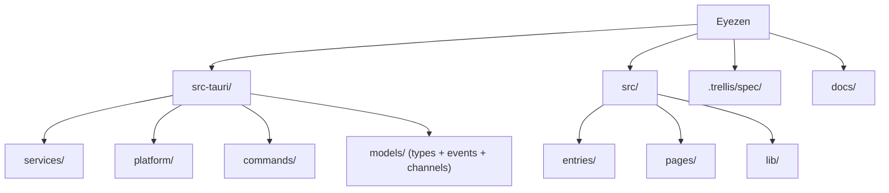

<!-- Trellis owns the generated block below. Remove the formatting guard when its template is Prettier-compatible. -->

<!-- prettier-ignore-start -->

<!-- TRELLIS:START -->
# Trellis Instructions

These instructions are for AI assistants working in this project.

This project is managed by Trellis. The working knowledge you need lives under `.trellis/`:

- `.trellis/workflow.md` — development phases, when to create tasks, skill routing
- `.trellis/spec/` — package- and layer-scoped coding guidelines (read before writing code in a given layer)
- `.trellis/workspace/` — per-developer journals and session traces
- `.trellis/tasks/` — active and archived tasks (PRDs, research, jsonl context)

If a Trellis command is available on your platform (e.g. `/trellis:finish-work`, `/trellis:continue`), prefer it over manual steps. Not every platform exposes every command.

If you're using Codex or another agent-capable tool, additional project-scoped helpers may live in:
- `.agents/skills/` — reusable Trellis skills
- `.codex/agents/` — optional custom subagents

Managed by Trellis. Edits outside this block are preserved; edits inside may be overwritten by a future `trellis update`.

<!-- TRELLIS:END -->

<!-- prettier-ignore-end -->

## Platform Files

Keep behavior in platform files; do not duplicate setup details across docs.

| Path                   | Purpose                                                                                        |
| ---------------------- | ---------------------------------------------------------------------------------------------- |
| `AGENTS.md`            | Shared project instructions, project index, and platform map for Claude Code and other agents. |
| `.trellis/workflow.md` | Canonical workflow and task routing.                                                           |
| `.trellis/spec/`       | Canonical coding and architecture rules.                                                       |
| `.claude/`             | Claude settings, hooks, agents, and skills.                                                    |
| `.codex/`              | Codex settings, hooks, and agents.                                                             |
| `.agents/skills/`      | Shared project skills.                                                                         |

### Change rules

- Workflow semantics: update `.trellis/workflow.md` first.
- Agent responsibilities: keep `.claude/agents/trellis-*` and `.codex/agents/trellis-*` aligned.
- Hook behavior: update both the platform config and the matching hook script.
- Documentation: link here instead of repeating platform setup text.

# Eyezen

A cross-platform desktop eye-care tool based on the 20-20-20 rule.

- Open source (GPL-3.0-or-later) and community driven.
- Supports Windows, macOS, and Linux.
- Offers fine-grained controls for technical users and sensible defaults for everyday use.

---

## Project Status

**Current stage: v0.7.1 released on 2026-05-25 as a patch release containing the v0.7.x hardening epic (PR #37). The project-wide architecture review and P0 fixes landed on 2026-07-03 (service initialization aligned with the DAG and models split, fb50077). The next decision is Phase 3 enhancements versus a v1.0.0 API freeze.**

- Scaffold: Tauri v2 + Svelte 5 + Vite 6 + TailwindCSS v4.
- Backend: nine services (Config, Timer, Detector, Window, Sound, Tray, I18n, Stat, and Hotkey), with Port traits, EffectSink, and pure-function abstractions introduced in v0.7.0 PRs #31/#32.
- Frontend: four windows (tray-panel, tip-window, tip-minimal, and main with Settings, About, and Statistics), zh-CN/en localization, and live dark/light theme switching.
- Platform adapters: Windows, macOS, and Linux implementations. macOS fullscreen detection uses CGWindowListCopyWindowInfo and CGGetActiveDisplayList, introduced in the v0.7.x epic when the capability was restored to true.
- CI/CD: three-platform ci.yml, four-target release.yml, eight shared local/cloud checks through `npm run ci`, and cargo-deny security checks.
- License: v0.1.0 binaries remain MIT; v0.2.0 and later use GPL-3.0-or-later.
- Coverage gates, introduced in v0.7.0: frontend `vitest --coverage` requires 90% lines, 85% functions, 80% branches, and 90% statements; backend `cargo llvm-cov` requires `--fail-under-lines 90 --fail-under-functions 85`.

### Release History

- **v0.1.0** (MIT, 2026-03-21, nine artifacts, draft): MVP scaffold, seven services, four windows, Settings/About/i18n/Theme/Autostart, and the CI/CD baseline.
- **v0.2.0** (GPL-3.0-or-later, 2026-05-20, ten artifacts): workday scheduling, an 880x560 main window, and Cargo.lock synchronization in bump-version.mjs.
- **v0.3.0** (2026-05-22, ten artifacts): AFK detection, SQLite statistics, ECharts trends, and configurable global hotkeys.
- **v0.4.0** (2026-05-22, ten artifacts): cross-platform process allowlists using Windows QueryFullProcessImageNameW, macOS kCGWindowOwnerName, and Linux X11 `_NET_WM_PID`.
- **v0.5.0** (2026-05-23): Pomodoro mode (TimerMode, PomodoroConfig, and alternating short/long breaks) and statistics database export with VACUUM INTO.
- **v0.6.0** (2026-05-23): Health Analysis, including the Eye-Care Index, adherence rate, and rhythm tracking.
- **v0.7.0** (2026-05-24, hardening release): nine PRs addressed fourteen P0/P1 audit findings. Changes covered npm vulnerabilities (#28), transactional statistics writes, export path validation and bounded channels (#27), conservative macOS fullscreen capability reporting (#29), defensive-code cleanup (#30), and WindowPort/TrayPort/EffectSink with pure tray_tooltip.rs/window_layout.rs functions (#31/#32). Tray/window service coverage reached approximately 93%+. Coverage gates started at 80%/70% (#26) and rose to 90%/85% (#33).
- **v0.7.1** (2026-05-25, patch release, ten artifacts): the v0.7.x hardening epic (PR #37, ten commits) closed the P2/P3 findings: F17 (stat.rs split into six stat/ modules), F18 (Settings/Statistics page decomposition), F19 (canonical en locale), F20 (IPC event constants), F16 (three IPC timeout classes), F22 (narrower capability emit permissions), F25 (documentation drift), F29 (documented platform path limitations), F03/F28 (real macOS fullscreen detection), and automatic tray-panel hiding on blur.

### Next Steps

- Decide between further Phase 3 work (export enhancements, global hotkey polish, and monthly reports) and a v1.0.0 SemVer freeze with a documentation site.
- Unscheduled architecture-review P2 items: rename the ServiceContext orchestration role, rehearse SQLite schema migrations, diagnose stale allowlist entries, and add frontend E2E smoke tests.
- Deferred to v1.0.0 or unscheduled: 95% coverage, mini/corner tip-window modes, F15 statistics full-table scan optimization, and F06/F07 API renaming and Beta removal.

---

## Technology Stack (Pinned Versions)

| Layer         | Choice                   | Version Constraint | Actual Version           | Notes                             |
| ------------- | ------------------------ | ------------------ | ------------------------ | --------------------------------- |
| Framework     | Tauri                    | v2 (`~2.x`)        | `~2.10`                  | Cross-platform Rust backend       |
| Frontend      | Svelte 5 (Runes)         | `~5.x`             | `~5.55.0`                | Compile-time reactivity           |
| Build         | Vite                     | `~6.x`             | `~6.4.1`                 | Fast HMR                          |
| CSS           | TailwindCSS              | v4 (`~4.x`)        | `~4.2.1`                 | Utility-first CSS                 |
| Charts        | ECharts                  | Tree-shaken        | `~6.1.0`                 | Statistics trends                 |
| Autostart     | tauri-plugin-autostart   | `~2.2`             | `~2.2`                   | Start at login                    |
| Database      | SQLite                   | Via sqlx           | `~0.8.6`                 | Persistent statistics             |
| Configuration | TOML                     | Human-readable     | `~0.8`                   |                                   |
| Type bindings | ts-rs                    | Stable             | `~10.1` (dev-dep)        | Rust to TypeScript                |
| Logging       | tracing + daily rotation | --                 | `~0.1` / `~0.3` / `~0.2` | tracing, subscriber, and appender |
| Audio         | rodio                    | Dedicated thread   | `~0.20`                  |                                   |
| Serialization | serde + serde_json       | `~1.0`             | `~1.0`                   |                                   |
| Async runtime | tokio                    | `~1.x`             | `~1.50` (full)           |                                   |
| Tests         | Vitest                   | `~3.x`             | `~3.2.4`                 |                                   |
| Type checking | svelte-check             | `~4.x`             | `~4.4.5`                 |                                   |

---

## Architecture Overview

```text
Frontend (Svelte 5, per window)
  |-- invoke()  -> Rust Commands (thin layer)
  `-- listen()  <- Rust Events (typed emit)
                       |
                  AppServices (Arc, Tauri State)
                  |-- ConfigService    TOML read/write + watch channel
                  |-- TimerService     Pure state machine + tokio timer + EffectSink
                  |-- DetectorService  Fullscreen detection + AFK + process allowlists
                  |-- WindowService    Multi-monitor tip windows (WindowPort trait)
                  |-- SoundService     Dedicated rodio thread + mpsc
                  |-- TrayService      Tray menu + tooltip (TrayPort trait)
                  |-- I18nService      Live language switching
                  |-- StatService      SQLite statistics + ECI + health analysis + export
                  `-- HotkeyService    Global hotkeys (feature flag)
```

Detailed constraints: [`.trellis/spec/architecture/layering.md`](.trellis/spec/architecture/layering.md) and [`.trellis/spec/backend/service-pattern.md`](.trellis/spec/backend/service-pattern.md).

---

## Module Structure



### Module Index

| Module             | Path                                 | Status      | Responsibility                                                                                 |
| ------------------ | ------------------------------------ | ----------- | ---------------------------------------------------------------------------------------------- |
| Rust entrypoints   | `src-tauri/src/main.rs`, `lib.rs`    | Implemented | Tauri Builder startup and service orchestration                                                |
| ConfigService      | `src-tauri/src/services/config.rs`   | Implemented | TOML read/write and live updates through arc-swap                                              |
| TimerService       | `src-tauri/src/services/timer/`      | Implemented | Pure state machine and tokio timer loop                                                        |
| DetectorService    | `src-tauri/src/services/detector.rs` | Implemented | Fullscreen detection through platform adapters                                                 |
| WindowService      | `src-tauri/src/services/window.rs`   | Implemented | Multi-monitor tip-window lifecycle                                                             |
| SoundService       | `src-tauri/src/services/sound.rs`    | Implemented | Dedicated rodio thread and mpsc                                                                |
| TrayService        | `src-tauri/src/services/tray.rs`     | Implemented | Tray menu, tooltip, and live localization                                                      |
| StatService        | `src-tauri/src/services/stat/`       | Implemented | SQLite persistence and trend aggregation through writer/migration/export/trends/health modules |
| I18nService        | `src-tauri/src/services/i18n.rs`     | Implemented | zh-CN/en localization and tray translation                                                     |
| PlatformApi        | `src-tauri/src/platform/`            | Implemented | Windows/macOS/Linux platform abstraction                                                       |
| Commands           | `src-tauri/src/commands/`            | Implemented | Thin Tauri command layer                                                                       |
| Models             | `src-tauri/src/models/`              | Implemented | Shared types, IPC events, and configuration models                                             |
| Error              | `src-tauri/src/error.rs`             | Implemented | AppError and IPC serialization                                                                 |
| Logging            | `src-tauri/src/logging.rs`           | Implemented | tracing and log rotation                                                                       |
| ServiceContext     | `src-tauri/src/services/context.rs`  | Implemented | Inter-service communication context                                                            |
| HTML entrypoints   | `*.html` (repository root)           | Present     | Vite multi-entry pages                                                                         |
| Frontend entries   | `src/entries/`                       | Present     | Window TypeScript entrypoints                                                                  |
| Frontend pages     | `src/pages/`                         | Implemented | tray-panel, tip-window, tip-minimal, settings, and about                                       |
| Frontend libraries | `src/lib/`                           | Implemented | Bindings, commands, events, stores, and i18n                                                   |

---

## Delivery Phases

### MVP: Core Functionality

Timer state machine, multi-monitor tip windows, tray integration, fullscreen do-not-disturb behavior, basic configuration, ts-rs type bindings, and Settings/tip/tray/About pages.

### Phase 2: Enhancements

AFK detection (v0.3.0), process allowlists (v0.4.0), SQLite statistics and ECharts (v0.3.0), and workday scheduling (v0.2.0).

### Phase 3: Advanced Features

Health analysis (v0.6.0), Pomodoro mode (v0.5.0), data export (v0.5.0), and global hotkeys (v0.3.0). See Project Status for the v0.7.x candidates.

---

## Development Commands

```bash
npm install                  # Install dependencies
npm run tauri dev            # Development mode
npm run tauri build          # Production build
npm run format               # Format with Prettier
npm run format:check         # Check Prettier formatting
cargo fmt --all --manifest-path src-tauri/Cargo.toml          # Format Rust
cargo clippy --manifest-path src-tauri/Cargo.toml --all-targets -- -D warnings  # Rust lint
cargo test --manifest-path src-tauri/Cargo.toml               # Rust tests
npx svelte-check --tsconfig ./tsconfig.json                   # Frontend type check
npm test                     # Frontend tests
npm run build                # Frontend build check
```

---

## Mandatory Rules and Constraints

> **All development MUST follow the specifications under `.trellis/spec/`. Code that violates them must not be merged.**
>
> Each group's `index.md` provides the complete navigation.

| Group                    | Index                                                                | Key Constraints                                                                                       |
| ------------------------ | -------------------------------------------------------------------- | ----------------------------------------------------------------------------------------------------- |
| Cross-layer architecture | [`.trellis/spec/architecture/`](.trellis/spec/architecture/index.md) | Layering, IPC contracts, state machine, change checklists, test quality, and releases                 |
| Rust backend             | [`.trellis/spec/backend/`](.trellis/spec/backend/index.md)           | Service DAG, four lifecycle phases, error propagation, locks/async, platform degradation, and tracing |
| Svelte frontend          | [`.trellis/spec/frontend/`](.trellis/spec/frontend/index.md)         | Svelte 5 Runes, one source of truth, ts-rs bindings, CSP/capabilities, and CSS variables              |
| Thinking guides          | [`.trellis/spec/guides/`](.trellis/spec/guides/index.md)             | Cross-layer reasoning and code reuse                                                                  |

### Quick Reference

| Task                                      | Read First                                                                                                                                                                |
| ----------------------------------------- | ------------------------------------------------------------------------------------------------------------------------------------------------------------------------- |
| Add a service                             | [`backend/service-pattern.md`](.trellis/spec/backend/service-pattern.md)                                                                                                  |
| Add a Tauri command                       | [`architecture/ipc-and-state.md`](.trellis/spec/architecture/ipc-and-state.md) and [`architecture/change-management.md`](.trellis/spec/architecture/change-management.md) |
| Change the timer state machine            | [`architecture/ipc-and-state.md`](.trellis/spec/architecture/ipc-and-state.md)                                                                                            |
| Work on Rust errors, locks, or async code | [`backend/coding-standards.md`](.trellis/spec/backend/coding-standards.md)                                                                                                |
| Change platform code                      | [`backend/platform-storage.md`](.trellis/spec/backend/platform-storage.md)                                                                                                |
| Add frontend pages or components          | [`frontend/component-guidelines.md`](.trellis/spec/frontend/component-guidelines.md) and [`frontend/quality-guidelines.md`](.trellis/spec/frontend/quality-guidelines.md) |
| Change stores or IPC calls                | [`frontend/store-and-ipc-patterns.md`](.trellis/spec/frontend/store-and-ipc-patterns.md)                                                                                  |
| Review before committing                  | [`architecture/testing-quality.md`](.trellis/spec/architecture/testing-quality.md)                                                                                        |
| Prepare a release                         | [`architecture/change-management.md`](.trellis/spec/architecture/change-management.md) and [`docs/workflows/release.md`](docs/workflows/release.md)                       |

---

## Documentation Index

### Design and Planning

| Document                         | Path                                                                | Purpose                                        |
| -------------------------------- | ------------------------------------------------------------------- | ---------------------------------------------- |
| Rebuild design specification     | `docs/.local/specs/2026-03-18-eyezen-rebuild-design.md`             | Core reference                                 |
| Frontend prototype specification | `docs/.local/specs/2026-03-19-frontend-prototype-design.md`         | tray-panel and tip-window design               |
| Settings/About specification     | `docs/.local/specs/2026-03-20-main-window-settings-about-design.md` | Settings and About UI                          |
| i18n specification               | `docs/.local/specs/2026-03-20-i18n-design.md`                       | Full-stack localization                        |
| Theme/Autostart specification    | `docs/.local/specs/2026-03-20-theme-autostart-design.md`            | Theme switching and startup behavior           |
| Frontend prototype mockup        | `docs/.local/mockups/2026-03-19-tray-tip-v4.html`                   | Adopted v4 visual prototype; open in a browser |
| Theme comparison mockup          | `docs/.local/mockups/2026-03-20-theme-comparison.html`              | Dark/light visual comparison                   |
| Implementation plans             | `docs/plans/`                                                       | Feature slices named `<NNN>-<scope>.md`        |
| Detailed development workflow    | `docs/.local/dev-workflow.md`                                       | Ten-phase lifecycle, for local reference       |

### Workflows and CI

| Document               | Path                                  | Purpose                                                                |
| ---------------------- | ------------------------------------- | ---------------------------------------------------------------------- |
| Development workflow   | `docs/workflows/dev.md`               | Daily development loop and Git Hooks                                   |
| Release workflow       | `docs/workflows/release.md`           | Release rules, commands, and checks                                    |
| Release naming rules   | `docs/workflows/release-naming.md`    | Artifact naming conventions                                            |
| PR workflow            | `docs/workflows/pr.md`                | Pull request template and workflow                                     |
| Branch protection      | `docs/workflows/branch-protection.md` | GitHub Settings for main protection and automatic head-branch deletion |
| Documentation workflow | `docs/workflows/update-docs.md`       | Documentation synchronization                                          |
| Agent configuration    | `AGENTS.md`                           | Claude, Codex, and Trellis configuration navigation                    |
| CI configuration       | `.github/workflows/ci.yml`            | Three-platform CI matrix                                               |
| Release CI             | `.github/workflows/release.yml`       | Four-target release builds                                             |
| Release notes template | `.github/release.yml`                 | Automatic GitHub release notes                                         |

### Experience and Research

| Document              | Path                                 | Purpose                     |
| --------------------- | ------------------------------------ | --------------------------- |
| Phase 1 retrospective | `docs/.local/experience-review.md`   | Decisions to keep or change |
| Development log       | `docs/devlog.md`                     | Key decisions               |
| ProjectEye research   | `docs/.local/projecteye-research.md` | Competitor reference        |
| Blink Eye research    | `docs/.local/blinkeye-research.md`   | Competitor reference        |
| UI style comparison   | `docs/.local/style-comparison.html`  | Visual direction reference  |

---

## AI Usage Guidelines

### Implementation Order (Mandatory)

1. Read existing code and understand its patterns.
2. List the affected areas using the checklists in [`architecture/change-management.md`](.trellis/spec/architecture/change-management.md).
3. Define interfaces before filling in implementations.
4. Write the implementation.
5. Write the corresponding tests.
6. Run automated checks.
7. Update documentation when APIs change.

### Required AI Output

```text
Assumptions:       What was assumed
Docs checked:      Which documentation was consulted
Files touched:     Which files changed
Tests to run:      Which tests are needed
Open risks:        Known risks
```

### Session Management

Start a new session when any of these conditions applies:

- Changes exceed eight files or span more than three modules.
- The session covers more than one main feature.
- The AI repeatedly loses earlier assumptions.
- The context window has been compressed.

---

## Key Decisions

- License: GPL-3.0-or-later from the next release after v0.1.0; v0.1.0 artifacts remain MIT.
- Workflow: all changes to `main` go through PR; no direct release merges.
- Specs: canonical rules live in `.trellis/spec/`; do not duplicate them in root docs.
- CI: local and cloud checks share `npm run ci`; release packaging runs only on `v*` tags.
- Frontend: Vite multi-entry HTML files stay at repo root unless all Tauri URLs and Vite inputs are migrated together.

History lives in `CHANGELOG.md` and `docs/devlog.md`.
